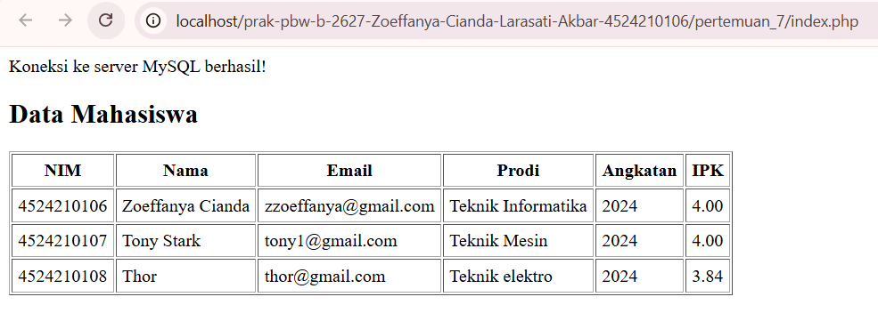
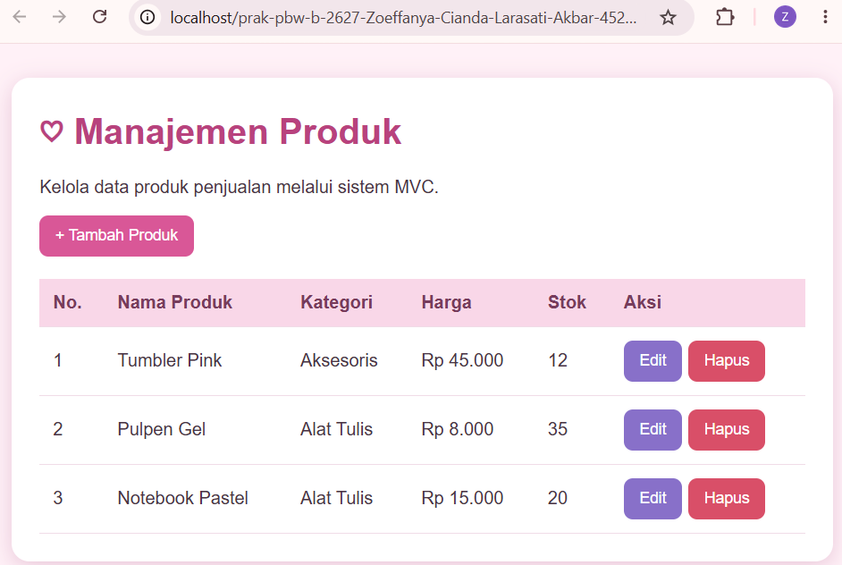
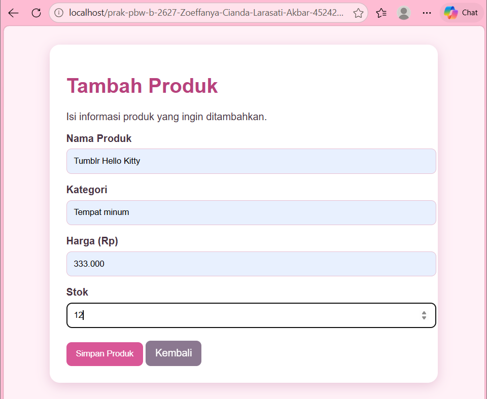
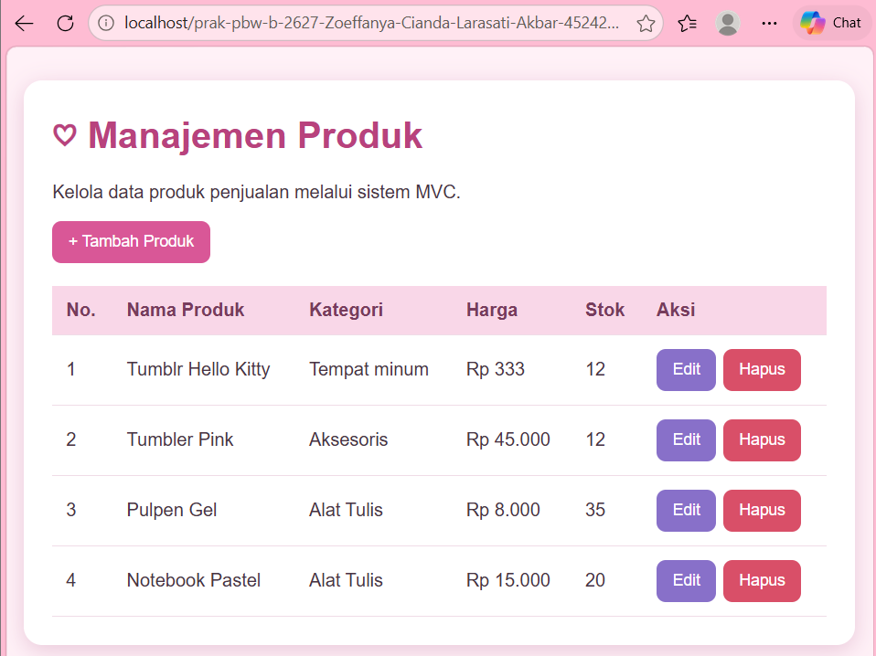
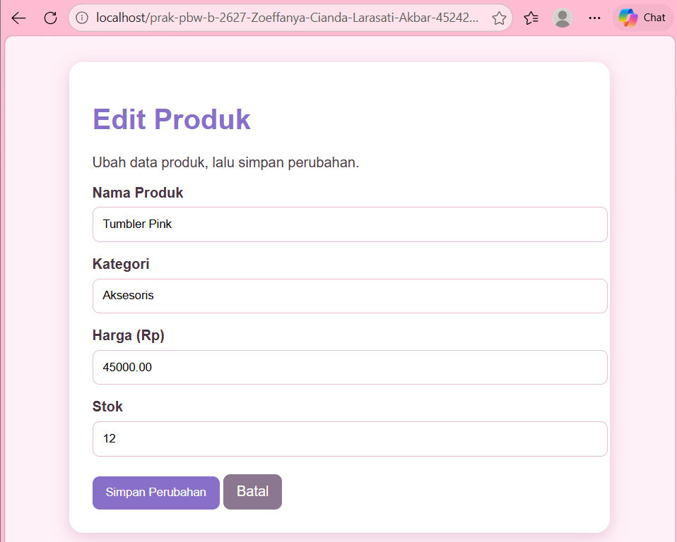
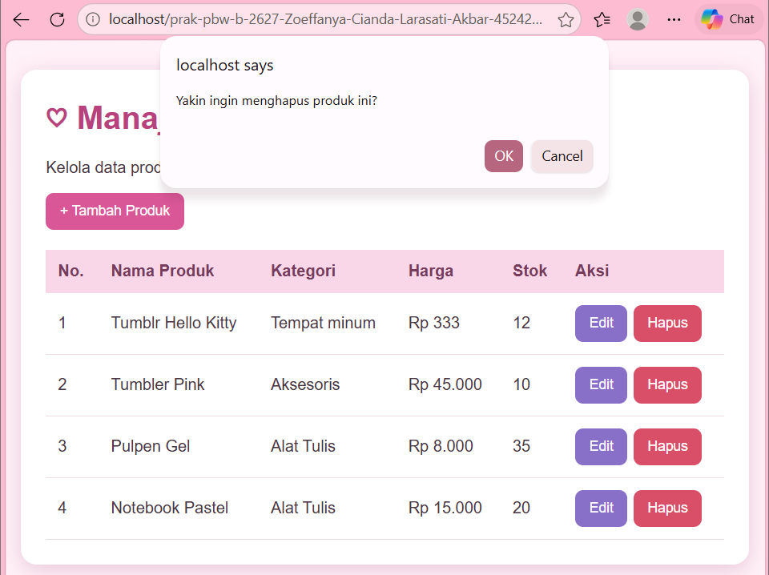
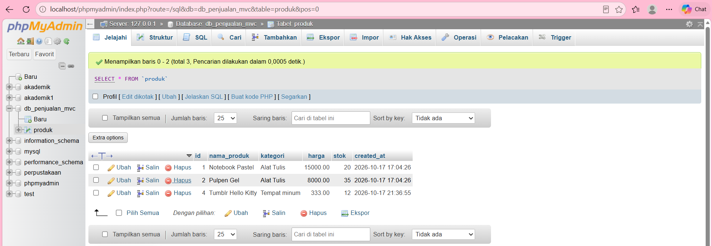

# **PERTEMUAN 7 — KONSEP MVC**

## **1. Pendahuluan**

Pada pertemuan 7 ini, saya mempelajari konsep MVC (*Model-View-Controller*) menggunakan PHP. MVC merupakan konsep yang membagi program menjadi tiga bagian, yaitu Model, View, dan Controller. Masing-masing bagian memiliki fungsi yang berbeda, tetapi saling berhubungan untuk menjalankan aplikasi.

Pada contoh yang terdapat di modul, MVC digunakan untuk menampilkan data mahasiswa. Sementara itu, pada tugas pertemuan 7, saya menerapkan konsep MVC untuk membuat aplikasi pengelolaan data produk sesuai dengan struktur folder yang telah ditentukan.

## **2. Struktur Folder**

Struktur folder dibuat dengan memisahkan file berdasarkan fungsinya agar kode lebih mudah dibaca dan dikelola.

Pada folder `Pertemuan_7`, terdapat contoh program Mahasiswa dari modul. Sedangkan folder `tugas_7` berisi program Produk yang dibuat untuk memenuhi tugas praktikum.

Struktur folder tugas 7 adalah sebagai berikut:

```text
tugas_7/
├── controllers/
│   └── ProdukController.php
├── models/
│   └── ProdukModel.php
├── views/
│   └── produk/
│       ├── create.php
│       ├── edit.php
│       └── index.php
├── index.php
└── koneksi.php
```

Keterangan:

1. `controllers/ProdukController.php` digunakan untuk mengatur alur program dan menghubungkan Model dengan View.
2. `models/ProdukModel.php` digunakan untuk mengelola data produk yang berhubungan dengan database.
3. `views/produk/index.php` digunakan untuk menampilkan daftar produk.
4. `views/produk/create.php` digunakan untuk menampilkan formulir tambah produk.
5. `views/produk/edit.php` digunakan untuk menampilkan formulir edit produk.
6. `index.php` digunakan sebagai halaman utama untuk menjalankan aplikasi.
7. `koneksi.php` digunakan untuk menghubungkan program dengan database MySQL.

## **3. Penjelasan Konsep MVC**

### **3.1. Model**

Model merupakan bagian yang berhubungan dengan pengolahan data. Pada tugas ini, file `ProdukModel.php` digunakan untuk menjalankan proses yang berkaitan dengan data produk, seperti mengambil, menambahkan, mengubah, dan menghapus data sesuai fungsi yang dibuat dalam program.

### **3.2. View**

View merupakan bagian yang menampilkan halaman kepada pengguna. Pada tugas ini, View terdiri dari halaman daftar produk, formulir tambah produk, dan formulir edit produk.

### **3.3. Controller**

Controller berfungsi mengatur alur program. File `ProdukController.php` menghubungkan proses pada Model dengan halaman View yang akan ditampilkan.

Dengan pembagian tersebut, setiap file mempunyai tugas masing-masing sehingga kode program lebih terstruktur.

## **4. Hasil Praktikum Sebelum**

Bagian ini menampilkan hasil program Mahasiswa dari contoh modul sebelum mengerjakan tugas pengelolaan data produk.

### **4.1. Tampilan Contoh Program Mahasiswa**



Gambar di atas menunjukkan hasil program Mahasiswa yang berhasil dijalankan melalui localhost. Halaman menampilkan data mahasiswa berupa NIM, nama, email, program studi, angkatan, dan IPK. Data yang ditampilkan terdiri dari tiga mahasiswa.

## **5. Hasil Tugas Setelah**

Pada tugas ini, saya membuat program dengan konsep MVC untuk mengelola data produk. Program disusun berdasarkan struktur folder pada instruksi tugas dan menggunakan database untuk menyimpan data produk.

### **5.1. Halaman Daftar Produk**



Halaman ini menampilkan data produk yang tersimpan di database. Dari halaman ini, pengguna dapat melihat daftar produk dan mengakses fitur pengelolaan data yang tersedia.

### **5.2. Form Tambah Produk**



Form tambah produk digunakan untuk memasukkan data produk baru. Data yang diisi kemudian diproses oleh program untuk disimpan ke database.

### **5.3. Hasil Penambahan Produk**



Gambar ini menunjukkan hasil setelah produk berhasil ditambahkan. Produk yang baru dimasukkan akan tampil pada daftar apabila proses penyimpanan berhasil.

### **5.4. Form Edit Produk**



Form edit digunakan untuk mengubah data produk yang sudah ada. Data produk yang dipilih ditampilkan kembali agar dapat diperbarui sesuai kebutuhan.

### **5.5. Hasil Perubahan Data Produk**


Gambar ini menunjukkan hasil setelah data produk berhasil diubah. Perubahan dapat dilihat pada daftar produk setelah proses penyimpanan selesai.

### **5.6. Proses Penghapusan Produk**



Bagian ini menunjukkan proses penghapusan data produk melalui fitur yang tersedia pada aplikasi.

### **5.7. Database Produk**



Database yang digunakan pada tugas ini adalah `db_penjualan_mvc`, dengan tabel `produk` untuk menyimpan data produk yang dikelola melalui aplikasi.

## **6. Pengujian Program**

Setelah program selesai dibuat, dilakukan pengujian untuk memastikan fitur yang tersedia dapat berjalan sesuai fungsinya.

Pengujian meliputi:

1. Membuka halaman utama untuk melihat daftar produk.
2. Menambahkan produk baru melalui formulir tambah produk.
3. Memeriksa apakah produk yang ditambahkan muncul pada daftar.
4. Mengubah data produk melalui formulir edit.
5. Memeriksa apakah perubahan data berhasil disimpan.
6. Menguji fitur penghapusan produk.
7. Memeriksa data pada database melalui phpMyAdmin.

Hasil pengujian dicatat berdasarkan fitur yang benar-benar berhasil dijalankan.

## **7. Cara Menjalankan Program**

Untuk menjalankan program, langkah-langkah yang dilakukan adalah:

1. Membuka XAMPP Control Panel.
2. Menjalankan Apache dan MySQL.
3. Memastikan database `db_penjualan_mvc` dan tabel `produk` sudah tersedia.
4. Menyimpan folder project di dalam direktori `htdocs`.
5. Membuka browser dan mengakses alamat berikut:

   `http://localhost/prak-pbw-b-2627-Zoeffanya-Cianda-Larasati-Akbar-4524210106/pertemuan_7/tugas_7/index.php`

6. Menguji fitur yang tersedia pada aplikasi.

## **8. Kesimpulan**

Dari praktikum pertemuan 7 ini, saya memahami bahwa konsep MVC membagi program menjadi tiga bagian, yaitu Model untuk mengelola data, View untuk menampilkan halaman, dan Controller untuk mengatur alur program.

Melalui tugas pengelolaan data produk, saya mempelajari bagaimana ketiga bagian tersebut saling berhubungan dalam sebuah aplikasi web. Dengan menggunakan konsep MVC, susunan kode menjadi lebih teratur dan setiap bagian program lebih mudah dipahami.