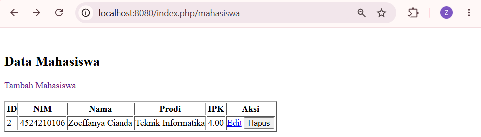
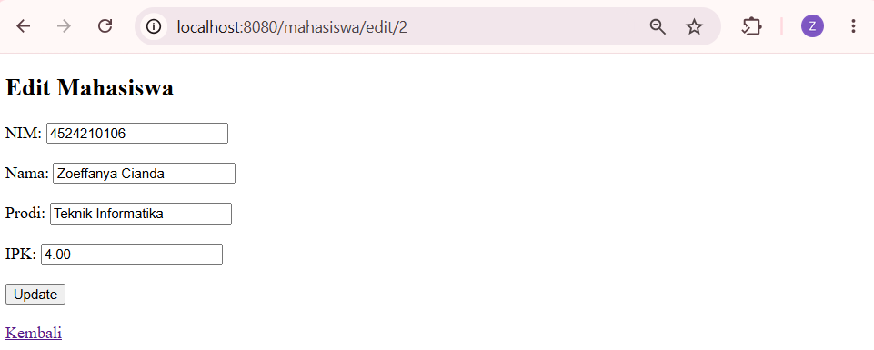
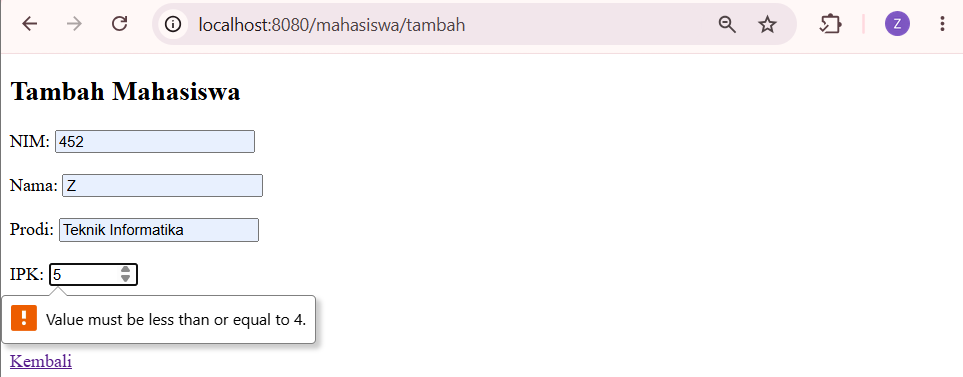
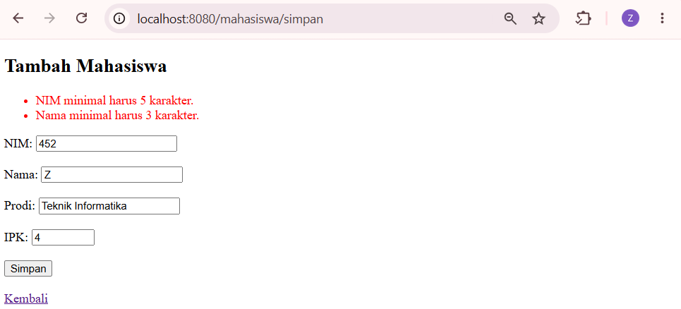

# Modul Data Mahasiswa - CodeIgniter 4

## Deskripsi
Proyek ini merupakan implementasi modul pengelolaan data mahasiswa menggunakan framework CodeIgniter 4 dan database MySQL.

## Fitur
- Menampilkan daftar mahasiswa.
- Menambahkan data mahasiswa.
- Mengubah data mahasiswa.
- Menghapus data mahasiswa.
- Validasi input menggunakan Validation Rules CodeIgniter 4.
- Menampilkan pesan kesalahan validasi pada halaman formulir.

## Teknologi
- PHP 8.2
- CodeIgniter 4
- MySQL
- XAMPP

## Struktur Data
Tabel yang digunakan adalah `mahasiswa`, dengan kolom:
- `id`: Primary Key dan Auto Increment.
- `nim`: Nomor Induk Mahasiswa.
- `nama`: Nama mahasiswa.
- `prodi`: Program studi.
- `ipk`: Indeks Prestasi Kumulatif.

## Cara Menjalankan
1. Jalankan Apache dan MySQL melalui XAMPP.
2. Buat database bernama `akademik_ci4`.
3. Buat tabel `mahasiswa` sesuai struktur database pada proyek.
4. Pastikan konfigurasi database di file `.env` sudah sesuai.
5. Buka terminal pada folder proyek.
6. Jalankan perintah:

   ```bash
   php spark serve
   ```

7. Buka alamat berikut pada browser:

   http://localhost:8080/mahasiswa

## Aturan Validasi
- NIM wajib diisi, minimal 5 dan maksimal 20 karakter.
- Nama wajib diisi, minimal 3 dan maksimal 100 karakter.
- Program studi wajib diisi, maksimal 100 karakter.
- IPK wajib diisi, harus berupa angka antara 0 sampai 4.
## Dokumentasi Screenshot

### 1. Daftar Mahasiswa


### 2. Edit Mahasiswa


### 3. Tambah Mahasiswa


### 4. Validasi Input

