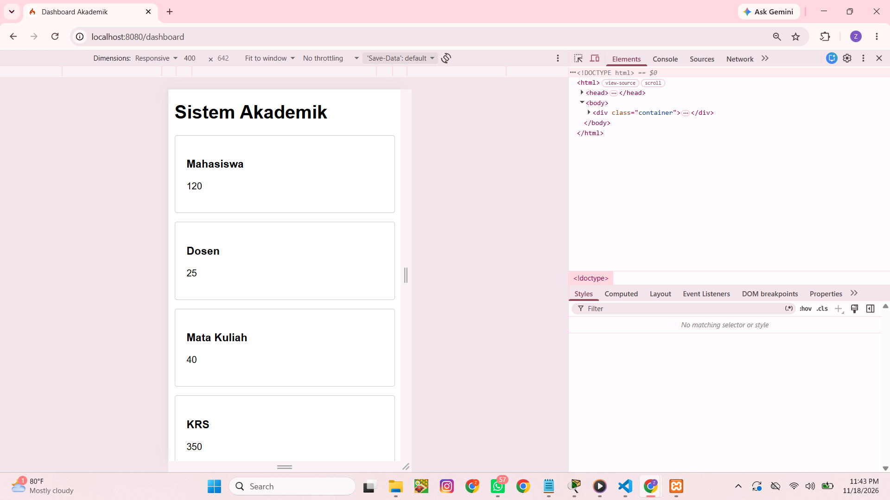
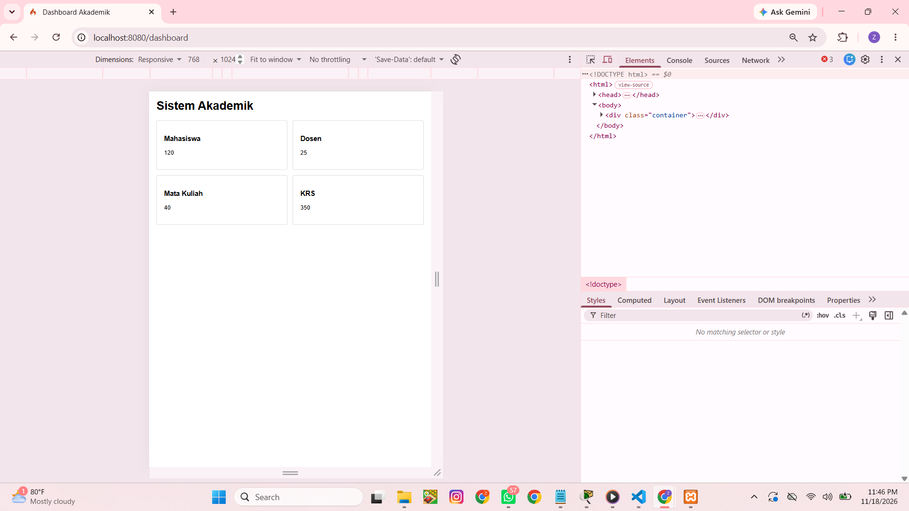
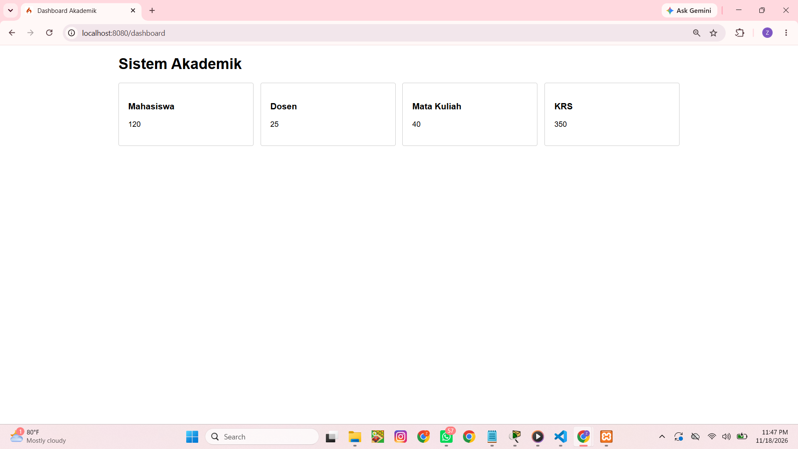

# Sistem Akademik Responsif - CodeIgniter 4

## Deskripsi
Proyek ini merupakan pengembangan Sistem Akademik menggunakan CodeIgniter 4 dengan menerapkan Responsive Web Design. Tampilan website dibuat agar dapat menyesuaikan ukuran layar desktop, tablet, dan smartphone.

## Tujuan
Menerapkan desain web responsif sehingga tampilan Sistem Akademik tetap nyaman dilihat dan digunakan pada berbagai ukuran layar.

## Teknologi
- PHP 8.2
- CodeIgniter 4
- HTML
- CSS
- XAMPP

## Konsep yang Diterapkan
- **Responsive Web Design:** tampilan menyesuaikan ukuran layar perangkat.
- **Viewport:** mengatur area tampilan halaman pada perangkat.
- **Media Query:** memberikan aturan CSS berbeda berdasarkan ukuran layar.
- **CSS Grid dan Flexbox:** membantu mengatur susunan elemen halaman.
- **Mobile First Design:** merancang tampilan untuk layar kecil sebelum diperluas ke layar lebih besar.

## Halaman yang Dikembangkan
Halaman Dashboard Sistem Akademik menampilkan empat informasi utama:
- Mahasiswa
- Dosen
- Mata Kuliah
- KRS

## Pengujian Responsif
Tampilan diuji menggunakan fitur Device Toolbar pada browser Google Chrome dengan tiga ukuran perangkat:

1. Smartphone
2. Tablet
3. Desktop

## Cara Menjalankan
1. Jalankan Apache dan MySQL melalui XAMPP.
2. Buka terminal pada folder proyek.
3. Jalankan perintah:

   ```bash
   php spark serve
   ```

4. Buka browser dan akses:

   http://localhost:8080/dashboard

## Dokumentasi Screenshot

### 1. Tampilan Smartphone


### 2. Tampilan Tablet


### 3. Tampilan Desktop

