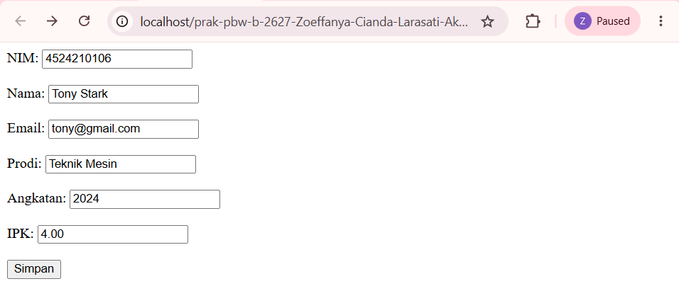
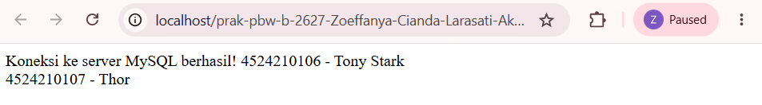
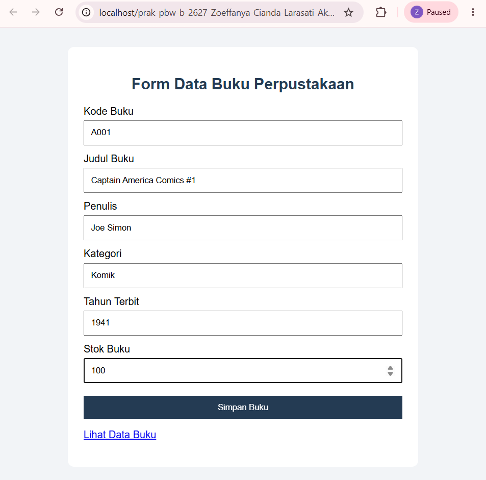
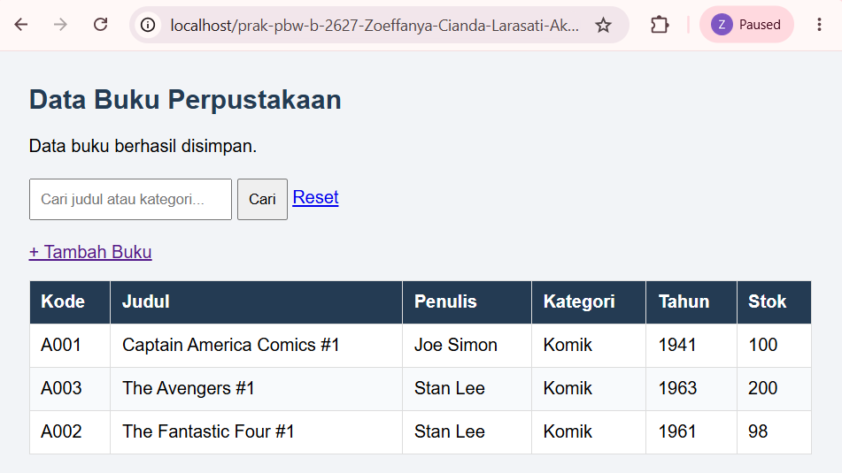
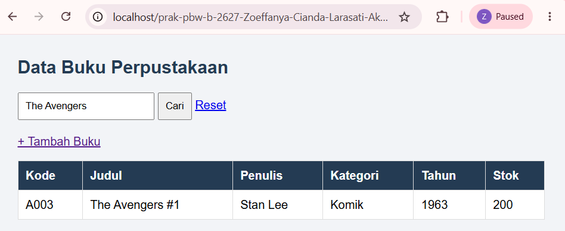

# **TUGAS 5 PBW B — DATA BUKU PERPUSTAKAAN**

## **1. Deskripsi Program**

Pada Tugas 5 ini, saya membuat program sederhana untuk mengelola data buku perpustakaan menggunakan PHP dan MySQL. Program ini merupakan pengembangan dari contoh praktikum Pertemuan 5 yang menggunakan data mahasiswa. Pada tugas ini, saya menggunakan studi kasus perpustakaan agar program dapat digunakan untuk mengelola informasi buku.

Program memiliki beberapa fungsi, yaitu menambahkan data buku, menyimpan data ke database, menampilkan daftar buku, dan mencari buku berdasarkan judul atau kategori. Dengan adanya fitur tersebut, data buku menjadi lebih mudah dikelola dan dicari.

## **2. Teknologi yang Digunakan**

Teknologi yang digunakan dalam pembuatan program ini adalah:

- **PHP** untuk memproses input dan menjalankan logika program.
- **MySQL** untuk menyimpan data buku ke dalam database.
- **HTML** untuk membuat formulir input dan tabel data.
- **CSS** untuk mengatur tampilan halaman agar lebih rapi.
- **XAMPP** sebagai lingkungan server lokal untuk menjalankan PHP dan MySQL.

## **3. Struktur File**

Berikut adalah file-file yang digunakan dalam program Tugas 5:

- `koneksi.php`: menghubungkan program PHP dengan database MySQL.
- `setup.php`: membuat database `perpustakaan` dan tabel `buku` jika belum tersedia.
- `form.php`: menampilkan formulir untuk memasukkan data buku.
- `simpan.php`: memeriksa input dan menyimpan data buku ke database.
- `data.php`: menampilkan daftar buku dan menyediakan fitur pencarian.
- `screenshots/`: menyimpan dokumentasi tampilan program sebelum dan sesudah modifikasi.

## **4. Modifikasi Program**

Pada tugas ini, saya melakukan beberapa modifikasi agar program sesuai dengan kebutuhan pengelolaan data buku perpustakaan.

### **4.1 Menambahkan Field Kategori Buku**

Modifikasi pertama adalah menambahkan field `kategori` pada tabel database dan formulir input buku. Field ini digunakan untuk mengelompokkan buku berdasarkan jenisnya, misalnya pemrograman, novel, atau sejarah.

Dengan adanya kategori, informasi buku menjadi lebih lengkap. Kategori juga dapat digunakan sebagai salah satu kriteria ketika pengguna melakukan pencarian.

### **4.2 Menambahkan Fitur Pencarian Buku**

Modifikasi kedua adalah menambahkan fitur pencarian pada halaman daftar buku. Pengguna dapat mencari buku berdasarkan judul atau kategori tanpa harus memeriksa seluruh data satu per satu.

Fitur ini menggunakan kondisi SQL `LIKE` untuk mencari data yang sesuai dengan kata kunci. Jika ditemukan data yang cocok, hasilnya akan ditampilkan pada tabel. Jika tidak ada data yang sesuai, program menampilkan informasi bahwa data buku tidak ditemukan.

### **4.3 Menambahkan Validasi Input dan Memperbaiki Tampilan**

Selain dua modifikasi utama tersebut, saya juga menambahkan validasi input untuk memeriksa kelengkapan data serta memastikan tahun terbit dan stok sesuai dengan ketentuan program.

Formulir dan tabel juga dilengkapi dengan CSS agar informasi lebih rapi dan mudah dibaca. Pada proses penyimpanan, penggunaan prepared statement membantu memisahkan perintah SQL dari nilai input pengguna.

## **5. Penjelasan Lima Bagian Kode yang Penting**

### **5.1 Koneksi ke Database (`koneksi.php`)**

File `koneksi.php` digunakan untuk menghubungkan program PHP dengan database MySQL. Fungsi `mysqli_connect()` digunakan untuk membuat koneksi. Jika koneksi gagal, program akan menghentikan proses dan menampilkan pesan kesalahan.

Bagian ini penting karena proses penyimpanan dan pengambilan data buku membutuhkan koneksi ke database.

### **5.2 Pembuatan Database dan Tabel (`setup.php`)**

File `setup.php` digunakan untuk menyiapkan database `perpustakaan` dan tabel `buku`. Perintah `CREATE DATABASE IF NOT EXISTS` digunakan untuk membuat database jika belum tersedia, sedangkan `CREATE TABLE IF NOT EXISTS` digunakan untuk membuat tabel beserta kolom yang diperlukan.

Tabel buku menyimpan informasi seperti kode buku, judul, penulis, kategori, tahun terbit, dan stok. Dengan struktur tersebut, data buku dapat disimpan secara teratur.

### **5.3 Pengiriman Data melalui Formulir (`form.php`)**

File `form.php` menampilkan formulir untuk memasukkan informasi buku. Formulir menggunakan metode `POST` dan mengirimkan data ke `simpan.php`.

Setiap elemen input memiliki atribut `name` agar nilainya dapat dibaca oleh PHP. Melalui formulir ini, pengguna dapat memasukkan informasi buku sebelum menyimpannya ke database.

### **5.4 Validasi dan Penyimpanan Data (`simpan.php`)**

File `simpan.php` bertugas memeriksa input dan menyimpan data buku. Fungsi `trim()` digunakan untuk menghapus spasi di awal dan akhir input. Program juga memeriksa kelengkapan data serta nilai tahun terbit dan stok sebelum melanjutkan proses penyimpanan.

Selanjutnya, `mysqli_prepare()` dan `mysqli_stmt_bind_param()` digunakan untuk menyiapkan query dan mengikat nilai input. Data kemudian disimpan menggunakan perintah SQL `INSERT`.

Validasi membantu mengurangi kemungkinan data yang tidak sesuai masuk ke database, sedangkan prepared statement membantu membuat proses penyimpanan lebih aman.

### **5.5 Menampilkan dan Mencari Data (`data.php`)**

File `data.php` digunakan untuk mengambil dan menampilkan data buku dari database. Perintah SQL `SELECT` digunakan untuk mengambil data, sedangkan kondisi `LIKE` digunakan ketika pengguna melakukan pencarian berdasarkan judul atau kategori.

Data ditampilkan menggunakan perulangan `while` dan fungsi `mysqli_fetch_assoc()`. Selain itu, `htmlspecialchars()` digunakan saat menampilkan nilai ke halaman HTML untuk membantu mencegah input ditafsirkan sebagai kode HTML.

Bagian ini membuat pengguna dapat melihat daftar buku sekaligus mencari data yang dibutuhkan.

## **6. Dokumentasi Screenshot**

Screenshot berikut digunakan untuk menunjukkan kondisi program sebelum dan sesudah modifikasi. Seluruh gambar pada bagian ini diambil dari program yang dijalankan sendiri menggunakan XAMPP dan browser.

### **6.1 Sebelum Modifikasi**

**Gambar 1. Formulir sebelum modifikasi**

**Gambar 2. Tampilan data sebelum modifikasi**

### **6.2 Sesudah Modifikasi**

**Gambar 3. Formulir input buku setelah modifikasi**

Gambar ini menunjukkan formulir input buku yang telah dilengkapi dengan field kategori.

**Gambar 4. Daftar buku setelah data disimpan**

Gambar ini menunjukkan data buku yang berhasil disimpan dan ditampilkan dalam tabel.

**Gambar 5. Hasil pencarian buku**

Gambar ini menunjukkan hasil pencarian berdasarkan judul atau kategori buku.

## **7. Pengujian Program**

Pengujian dilakukan dengan menjalankan Apache dan MySQL melalui XAMPP, kemudian membuka program menggunakan browser. Pengujian yang dilakukan meliputi:

1. Menjalankan `setup.php` untuk membuat database dan tabel buku.
2. Membuka `form.php` untuk memasukkan data buku.
3. Mengisi formulir dan menekan tombol simpan.
4. Membuka `data.php` untuk memastikan data berhasil disimpan dan ditampilkan.
5. Mencoba fitur pencarian berdasarkan judul atau kategori.
6. Memeriksa tampilan pesan ketika data tidak ditemukan, jika pengujian tersebut dilakukan.

Berdasarkan pengujian yang telah dilakukan, database dan tabel berhasil disiapkan. Data buku juga berhasil disimpan dan ditampilkan pada halaman daftar buku. Fitur pencarian digunakan untuk membantu menemukan buku berdasarkan judul atau kategori.

## **8. Error dan Cara Mengatasinya**

Pada pengujian akhir, database dan tabel berhasil dibuat, serta proses penyimpanan dan penampilan data buku dapat dijalankan.

Bagian ini perlu dilengkapi dengan satu error yang benar-benar pernah dialami selama pengerjaan, sesuai instruksi tugas. Tuliskan pesan error, penyebabnya, dan langkah penyelesaiannya berdasarkan kejadian yang sebenarnya. Jika tidak mengalami error, jangan membuat contoh error seolah-olah benar-benar terjadi.

## **9. Kesimpulan**

Melalui Tugas 5 ini, saya belajar membuat program pengelolaan data buku perpustakaan menggunakan PHP dan MySQL. Program mencakup proses koneksi database, pengisian formulir, validasi input, penyimpanan data, serta penampilan dan pencarian data buku.

Penambahan field kategori membuat informasi buku menjadi lebih lengkap, sedangkan fitur pencarian memudahkan pengguna menemukan buku berdasarkan judul atau kategori. Validasi input dan prepared statement juga membantu meningkatkan kualitas pengolahan data.

Secara keseluruhan, tugas ini membantu saya memahami penerapan PHP dan MySQL dalam membuat program sederhana yang dapat digunakan untuk mengelola data.
