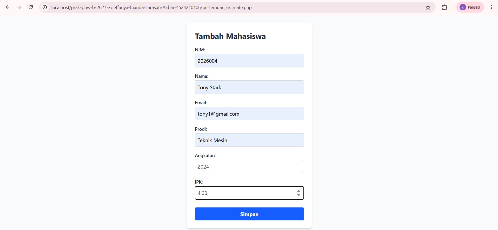
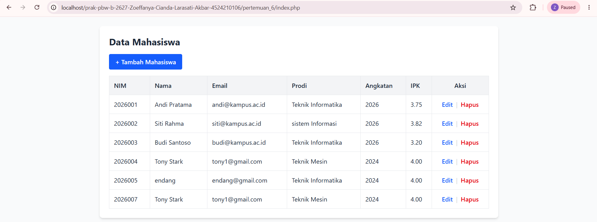
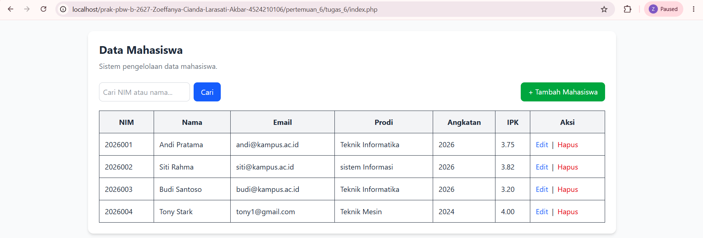
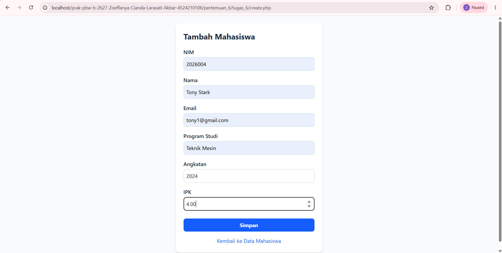
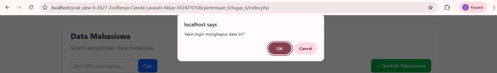
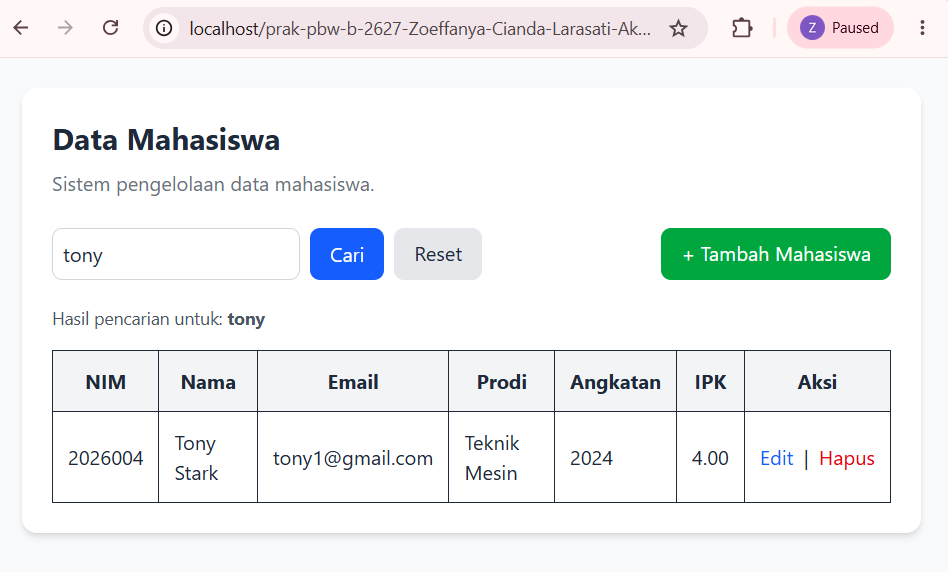

# **PRAKTIKUM DAN TUGAS 6 PBW B — PENGELOLAAN DATA MAHASISWA**

## **1. Deskripsi Praktikum dan Tugas**

Pada Pertemuan 6, saya mempelajari cara mengelola data mahasiswa menggunakan PHP dan MySQL. Program ini menerapkan proses pengelolaan data melalui operasi CRUD, yaitu *Create, Read, Update,* dan *Delete*.

Pada contoh praktikum, saya mempelajari cara menambahkan, menampilkan, mengubah, dan menghapus data mahasiswa. Setelah memahami cara kerja program contoh, saya mengembangkan program tersebut pada Tugas 6 dengan menambahkan fitur pencarian mahasiswa berdasarkan NIM atau nama.

Dengan pengembangan tersebut, program tidak hanya digunakan untuk mengelola data mahasiswa, tetapi juga memudahkan pengguna menemukan data yang dibutuhkan.

## **2. Teknologi yang Digunakan**

Teknologi yang digunakan dalam program ini adalah:

- **PHP** untuk memproses input dan menjalankan logika pengelolaan data.
- **MySQL** untuk menyimpan data mahasiswa.
- **HTML** untuk membuat formulir dan tabel data.
- **CSS** untuk mengatur tampilan halaman jika digunakan pada program.
- **XAMPP** sebagai lingkungan server lokal untuk menjalankan PHP dan MySQL.
- **Visual Studio Code** sebagai editor kode program.

## **3. Struktur File**

Berikut adalah file-file utama yang digunakan dalam program:

- `koneksi.php`: menghubungkan program PHP dengan database MySQL.
- `setup.php`: menyiapkan database atau tabel yang dibutuhkan.
- `index.php`: menampilkan daftar mahasiswa dan fitur pencarian pada program tugas.
- `create.php`: menampilkan formulir untuk menambahkan data mahasiswa.
- `store.php`: memproses dan menyimpan data mahasiswa baru.
- `edit.php`: menampilkan formulir untuk mengubah data mahasiswa.
- `update.php`: memproses perubahan data mahasiswa.
- `delete.php`: menjalankan proses penghapusan data mahasiswa.
- `screenshots/`: menyimpan dokumentasi tampilan program sebelum dan sesudah pengembangan.

Setiap file memiliki fungsi yang berbeda dan saling terhubung untuk menjalankan proses pengelolaan data.

## **4. Penjelasan Program dan Modifikasi**

### **4.1 Contoh Praktikum: Pengelolaan Data Mahasiswa**

Pada contoh praktikum, program digunakan untuk mempelajari proses dasar pengelolaan data mahasiswa. Fitur yang tersedia pada contoh yang saya gunakan meliputi penambahan, penampilan, pengubahan, dan penghapusan data, serta validasi input sesuai implementasi kode.

Melalui contoh ini, saya mempelajari bagaimana data yang dimasukkan melalui formulir diproses oleh PHP, disimpan ke database, kemudian ditampilkan kembali pada halaman web.

### **4.2 Modifikasi Pertama: Menambahkan Fitur Pencarian**

Modifikasi yang saya lakukan adalah menambahkan fitur pencarian mahasiswa berdasarkan NIM atau nama. Fitur ini menjadi pengembangan dari contoh praktikum yang saya gunakan, karena pada contoh tersebut belum tersedia kolom pencarian.

Pengguna dapat memasukkan NIM atau nama pada kolom pencarian, kemudian menekan tombol **Cari**. Program akan memproses kata kunci tersebut dan menampilkan data mahasiswa yang sesuai.

Fitur ini membuat proses pencarian lebih praktis, terutama ketika jumlah data mahasiswa semakin banyak.

### **4.3 Mempertahankan Fitur CRUD**

Selain menambahkan pencarian, program tugas tetap memiliki fungsi utama untuk mengelola data mahasiswa.

- **Create:** menambahkan data mahasiswa baru melalui formulir.
- **Read:** menampilkan data mahasiswa dalam bentuk tabel.
- **Update:** mengubah informasi mahasiswa yang sudah tersimpan.
- **Delete:** menghapus data mahasiswa setelah pengguna mengonfirmasi tindakannya.

Dengan adanya fitur-fitur tersebut, pengguna dapat melakukan pengelolaan data melalui satu program.

### **4.4 Validasi dan Penanganan Input**

Validasi digunakan untuk memeriksa data yang dimasukkan sebelum diproses. Pada proses penambahan data, NIM harus unik karena digunakan sebagai *Primary Key* pada database.

Jika pengguna mencoba menyimpan NIM yang sudah terdaftar, database akan menolak data tersebut. Hal ini menjaga agar tidak ada dua data mahasiswa yang menggunakan NIM yang sama.

## **5. Penjelasan Lima Bagian Kode yang Penting**

### **5.1 Koneksi ke Database (`koneksi.php`)**

File `koneksi.php` digunakan untuk menghubungkan PHP dengan database MySQL. Koneksi ini diperlukan agar program dapat mengambil, menambahkan, mengubah, dan menghapus data mahasiswa.

### **5.2 Menampilkan Data (`index.php`)**

File `index.php` digunakan untuk menampilkan daftar mahasiswa dalam bentuk tabel. Pada program tugas, halaman ini juga menyediakan fitur pencarian berdasarkan NIM atau nama.

### **5.3 Menambahkan Data (`create.php` dan `store.php`)**

File `create.php` menampilkan formulir input mahasiswa, sedangkan `store.php` memproses data yang dikirimkan dan menyimpannya ke database.

Pada proses ini, NIM harus unik karena digunakan sebagai *Primary Key*. Jika NIM sudah digunakan, data baru dengan NIM yang sama tidak dapat disimpan.

### **5.4 Mengubah Data (`edit.php` dan `update.php`)**

File `edit.php` digunakan untuk menampilkan formulir perubahan data mahasiswa. Setelah pengguna mengubah informasi dan mengirimkan formulir, `update.php` memproses perubahan tersebut ke database.

### **5.5 Menghapus Data (`delete.php`)**

File `delete.php` digunakan untuk menghapus data mahasiswa. Program menampilkan konfirmasi sebelum proses penghapusan dilakukan sehingga pengguna dapat memastikan kembali tindakannya.

## **6. Dokumentasi Screenshot**

Dokumentasi berikut memperlihatkan perbedaan antara contoh praktikum sebelum pengembangan dan program Tugas 6 setelah pengembangan.

### **6.1 Sebelum Pengembangan — Contoh Praktikum**

**Gambar 1. Formulir tambah mahasiswa pada contoh praktikum**

Gambar ini menunjukkan formulir yang digunakan untuk memasukkan data mahasiswa pada contoh praktikum.

**Gambar 2. Daftar mahasiswa pada contoh praktikum**

Gambar ini menunjukkan tampilan daftar mahasiswa pada program contoh sebelum ditambahkan fitur pencarian.

### **6.2 Sesudah Pengembangan — Tugas 6**

**Gambar 3. Tampilan daftar mahasiswa**

Gambar ini menunjukkan halaman daftar mahasiswa pada program Tugas 6. Halaman ini digunakan untuk melihat data yang sudah tersimpan dan mengakses fitur pengelolaan data yang tersedia.

**Gambar 4. Formulir tambah mahasiswa**

Gambar ini menunjukkan formulir yang digunakan untuk memasukkan data mahasiswa baru ke dalam sistem.

**Gambar 5. Konfirmasi penghapusan data mahasiswa**

Gambar ini menunjukkan pesan konfirmasi yang muncul ketika pengguna memilih tombol Hapus. Pesan tersebut memberi kesempatan kepada pengguna untuk memastikan tindakannya sebelum proses penghapusan dilanjutkan.

**Gambar 6. Fitur pencarian mahasiswa**

Gambar ini menunjukkan fitur pencarian yang ditambahkan pada Tugas 6. Pengguna dapat mencari data berdasarkan NIM atau nama sehingga informasi yang dibutuhkan lebih mudah ditemukan.

## **7. Pengujian Program**

Pengujian dilakukan dengan menjalankan Apache dan MySQL melalui XAMPP, kemudian membuka program melalui browser.

Langkah pengujian yang dilakukan meliputi:

1. Memastikan Apache dan MySQL berjalan.
2. Menyiapkan database dan tabel mahasiswa.
3. Membuka halaman daftar mahasiswa.
4. Menambahkan data mahasiswa melalui formulir.
5. Memeriksa apakah data baru muncul pada tabel.
6. Mengubah informasi mahasiswa dan memeriksa hasilnya.
7. Menguji konfirmasi penghapusan data.
8. Menggunakan fitur pencarian berdasarkan NIM atau nama.

Pengujian dilakukan untuk memeriksa apakah fungsi-fungsi program dapat digunakan sesuai tujuannya. Hasil setiap pengujian diperiksa melalui tampilan browser dan perubahan data pada tabel.

## **8. Error dan Cara Mengatasinya**

### **8.1 Error Duplicate Entry pada Primary Key**

Saat mencoba menambahkan data mahasiswa, program menampilkan pesan `Duplicate entry '2026004' for key 'PRIMARY'` pada file `store.php` baris 13.

Penyebabnya adalah NIM `2026004` sudah terdaftar di database. Karena NIM digunakan sebagai *Primary Key*, nilai tersebut tidak boleh sama dengan NIM mahasiswa lain.

Untuk mengatasinya, saya menggunakan NIM berbeda yang belum terdaftar ketika mencoba menambahkan data baru. Setelah itu, saya memeriksa halaman daftar mahasiswa untuk memastikan data berhasil disimpan.

Dari kejadian ini, saya memahami bahwa setiap data mahasiswa harus memiliki NIM yang unik agar dapat disimpan ke database.

## **9. Kesimpulan**

Melalui Pertemuan 6 dan Tugas 6 ini, saya mempelajari cara mengelola data mahasiswa menggunakan PHP dan MySQL. Program menerapkan operasi CRUD yang meliputi penambahan, penampilan, pengubahan, dan penghapusan data.

Pengembangan yang saya lakukan adalah menambahkan fitur pencarian berdasarkan NIM atau nama mahasiswa. Fitur ini membuat pencarian data lebih praktis dibandingkan harus memeriksa seluruh daftar secara manual.

Saya juga memahami pentingnya koneksi database, validasi input, aturan *Primary Key*, dan konfirmasi penghapusan dalam proses pengelolaan data. Dengan demikian, tugas ini membantu saya memahami penerapan PHP dan MySQL dalam membuat program pengelolaan data mahasiswa.
